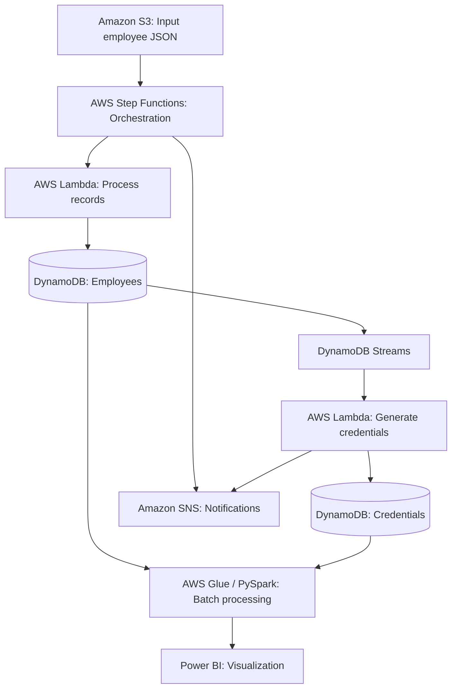

# AWS Serverless Workflow Architecture

This diagram represents the workflow documented in the original team project.

**Note:** This illustrates the architecture described in the original team project documentation. The AWS workflow is not deployed by this local demo.
